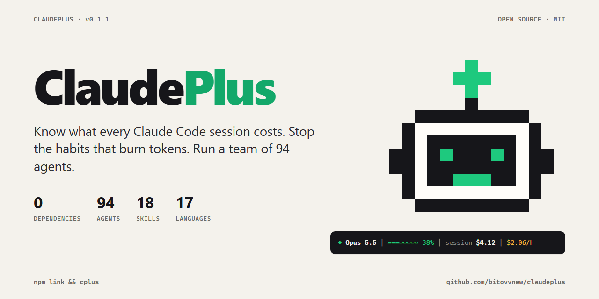
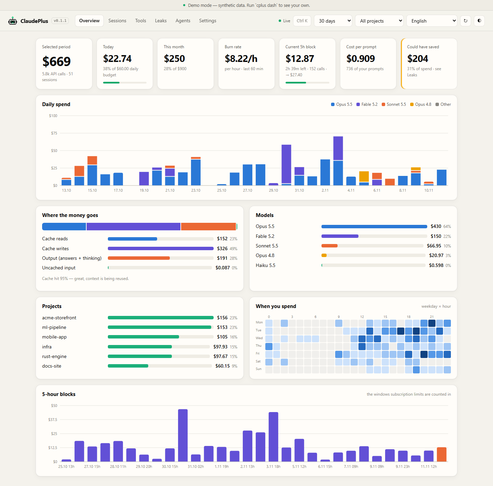
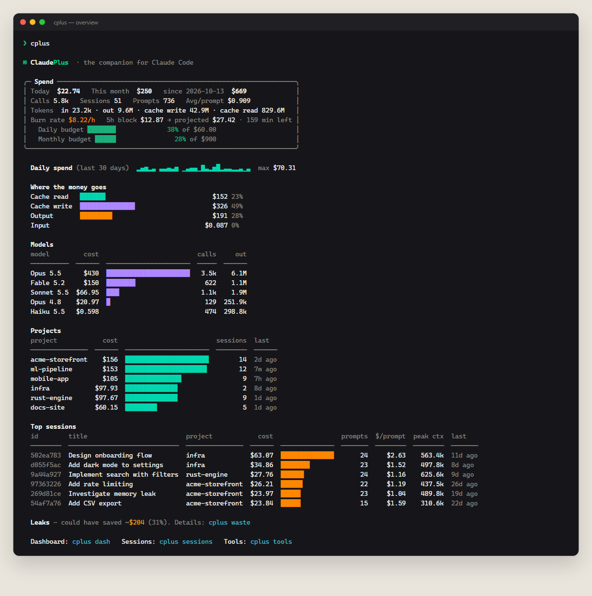
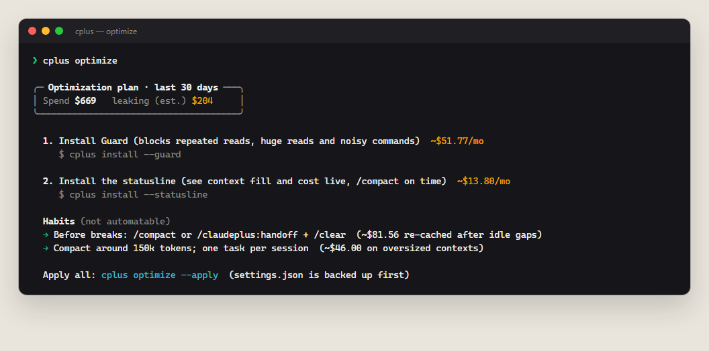
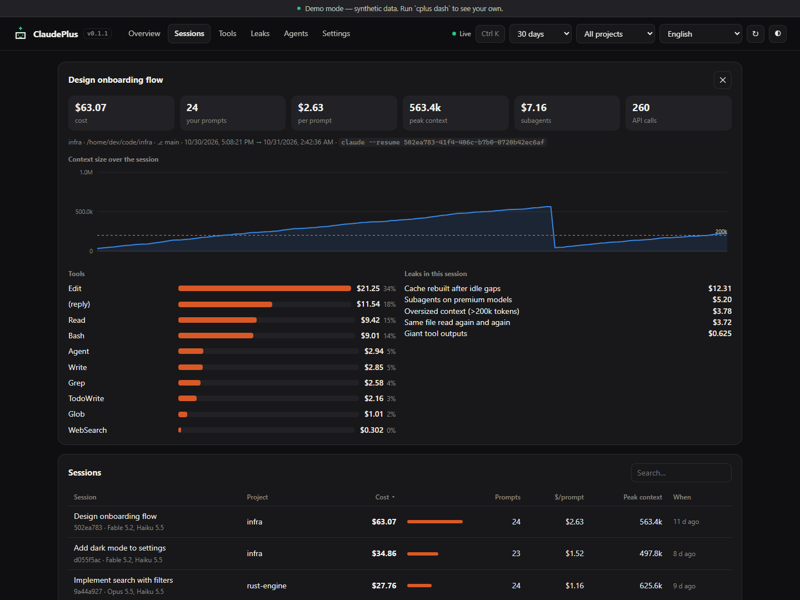
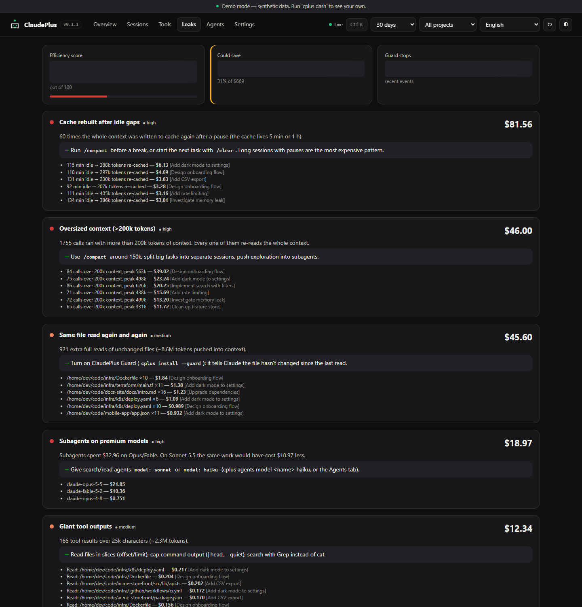
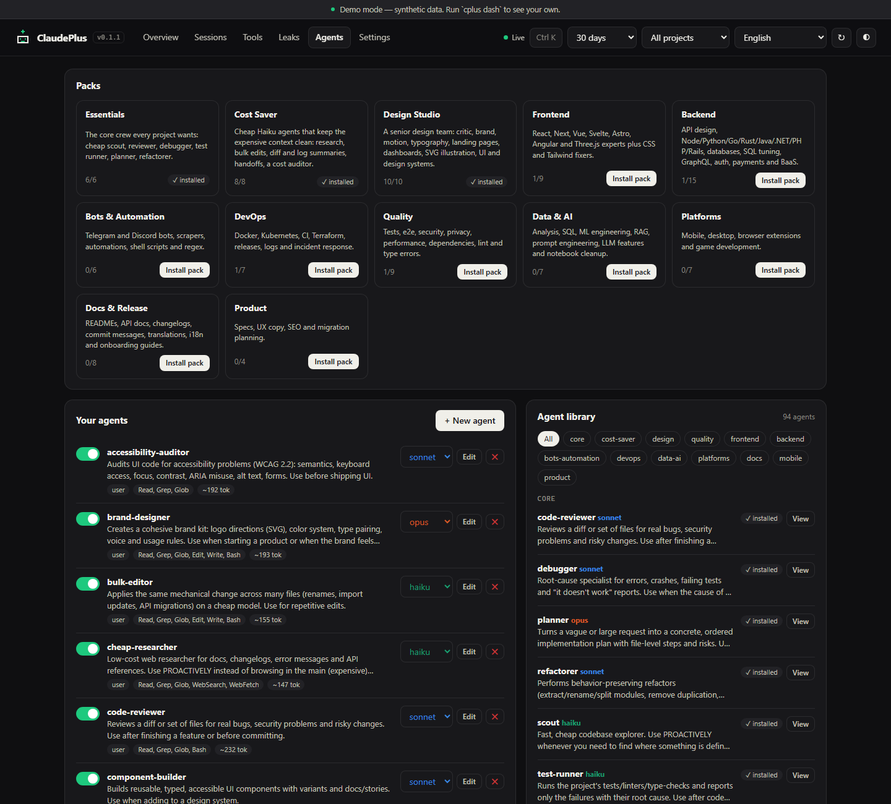
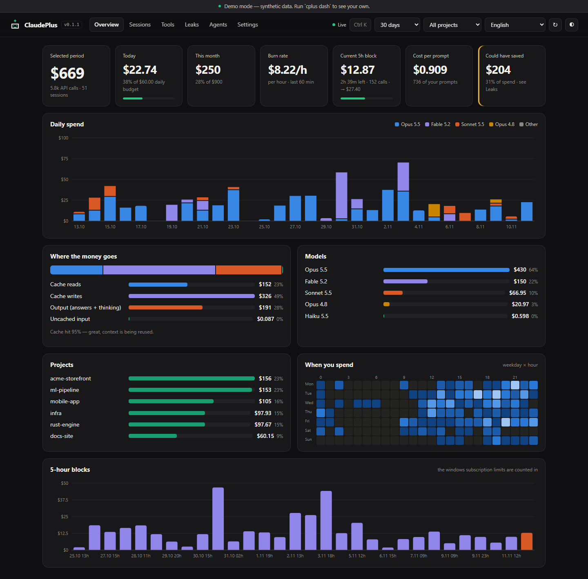

<p align="center">
  
</p>

<p align="center">
  <a href="https://github.com/bitovvnew/claudeplus/actions/workflows/ci.yml"></a>
  
  
  
  
</p>

**ClaudePlus** is a local companion for [Claude Code](https://code.claude.com). It reads the transcripts Claude Code already writes on your machine and tells you what each session, project, model and tool really cost. It also points out the habits that waste tokens and can stop them before they run. On top of that it ships 94 subagents and 18 skills that make Claude work like a well-run team.

It has no dependencies and no account, and nothing leaves your computer.

```bash
git clone https://github.com/bitovvnew/claudeplus.git && cd claudeplus && npm link
cplus demo        # look around on synthetic data first
cplus             # then your own numbers
```

**Windows quick start:** download or clone the repository, extract it, and double-click [`auto-connect.bat`](auto-connect.bat). You need Node.js 18 or newer; no Python, administrator rights or global npm install is required.

The launcher shows a **WARNING** and asks for confirmation before it reads your usage history or changes settings. After you type `y`, it backs up existing Claude Code settings, connects Guard and the statusline, and opens your own statistics in the local dashboard. It does not sign you into an account or upload your data. Keep this folder in place after connecting, and open a new Claude Code session to activate the integration. Closing the dashboard leaves the integration installed.

On macOS/Linux, or from a terminal on Windows:

```bash
node bin/cplus.js connect          # asks first, then connects and opens the dashboard
node bin/cplus.js uninstall        # removes the integration; preserves your transcripts
```

If you already used `npm link`, the same commands are `cplus connect` and `cplus uninstall`. Use `cplus dash` to view statistics without installing integrations, or `cplus demo` to explore synthetic data. `connect --yes` is available for deliberate, non-interactive setup.



---

## What it does

**Shows where the money goes.** Every API call is priced per model: input, output (including thinking), 5-minute and 1-hour cache writes, cache reads, fast mode and web search. You can view it by day, project, session, tool, subagent and 5-hour block (the windows subscription limits are counted in). History that `--resume` copies into a new session is counted once, not twice.

**Finds the leaks and fixes them.** `cplus waste` puts a dollar figure on six expensive patterns:

- the cache rebuilt after an idle gap;
- calls with 200k+ tokens of context;
- read-only subagents on Opus;
- the same unchanged file read again and again;
- giant tool outputs;
- the share of output that is thinking.

`cplus optimize` turns those findings into commands you can apply in one go.

**Prevents waste before it happens.** The Guard hook stops wasteful tool calls before they run: re-reading an unchanged file, a full read of a huge file, `git log` without a limit, recursive listings, and lockfile or log dumps. Claude gets a one-line reason, and an identical retry always goes through, so it is never stuck.

**Keeps you informed while you work.** A statusline in five themes shows context fill, live session cost, today against your budget and the burn rate. `cplus watch` is a live terminal monitor, and the dashboard (`cplus dash`) shows everything above with drill-downs.

**Gives Claude a team.** You get 94 subagents in 12 packs and 18 skills, all chosen with cost in mind: Haiku does the reading and searching, Sonnet does the engineering, and Opus is kept for design and planning. One command installs a whole pack.

<table>
<tr>
<td width="50%"></td>
<td width="50%"></td>
</tr>
</table>

## Numbers

| | |
|---|---|
| Transcript parsing | **325 MB/s**: 284 MB of history in 0.88 s cold, 46 ms when nothing changed |
| Statusline refresh | **~49 ms**, of which ~34 ms is Node starting up |
| Guard overhead | **~45 ms** per tool call |
| Runtime dependencies | **0** |
| Agents / packs / skills | **94 / 12 / 18** |
| Languages | **17**: English, Русский, Українська, Қазақша, Español, Português, Français, Deutsch, Italiano, Polski, Türkçe, 中文, 日本語, 한국어, हिन्दी, Bahasa Indonesia, Tiếng Việt |
| CI | Windows, macOS, Linux × Node 18 / 20 / 22 |

Measured with `npm run bench` on synthetic data (i5-12400F, Windows 11). Run it yourself.

In the author's own month of heavy use, the leak report put about 40% of API-equivalent spend into the avoidable column. Most of it was cache rebuilt after breaks and oversized contexts. Yours will differ, so run `cplus waste`.

## The dashboard

The overview, sessions, tools, leaks, agents and settings pages are available in light and dark themes and in 17 languages. Numbers count up, charts draw in, and bars grow from the baseline. Background refreshes stay still, and everything turns off under `prefers-reduced-motion`. Press <kbd>Ctrl</kbd>/<kbd>⌘</kbd>+<kbd>K</kbd> for the command palette, which lets you jump to any session, switch range, theme or language. <kbd>1</kbd>–<kbd>6</kbd> switch tabs and <kbd>/</kbd> searches sessions.

<table>
<tr>
<td width="50%"></td>
<td width="50%"></td>
</tr>
<tr>
<td width="50%"></td>
<td width="50%"></td>
</tr>
</table>

## Agents, packs and skills

| Pack | What you get |
|---|---|
| `essentials` | scout, code-reviewer, debugger, test-runner, planner, refactorer |
| `cost-saver` | cheap-researcher, bulk-editor, diff-summarizer, context-keeper, repo-mapper, log-analyst, cost-auditor |
| `design-studio` | design-critic, brand-designer, ui-designer, motion-designer, typography-expert, landing-page-builder, dashboard-designer, svg-illustrator… |
| `frontend` | React, Next.js, Vue, Svelte, Astro, Angular, Three.js, CSS, Tailwind |
| `backend` | API design, Node, Python, Go, Rust, Java, .NET, PHP, Rails, databases, SQL, GraphQL, auth, Stripe, Supabase |
| `bots-automation` | Telegram and Discord bots, scrapers, automations, shell scripts, regex |
| `devops` · `quality` · `data-ai` · `platforms` · `docs` · `product` | CI, Docker, k8s, Terraform, tests, security, privacy, ML, RAG, mobile, desktop, games, docs, i18n, specs… |

Skills are playbooks Claude loads when the task fits. They cover `token-diet`, `spec-driven-dev`, `human-grade-ui`, `design-system`, `motion-design`, `landing-page`, `code-review`, `debugging-playbook`, `safe-migrations`, `security-checklist`, `release-checklist` and more.

```bash
cplus agents pack design-studio     # a whole team at once
cplus agents model scout haiku      # change any agent's model
cplus skills add token-diet human-grade-ui
```

Full catalogs: [docs/AGENTS.md](docs/AGENTS.md) and [docs/SKILLS.md](docs/SKILLS.md).

### Spec-driven slash commands

The optional plugin adds commands that keep Claude on rails:

| Command | Does |
|---|---|
| `/claudeplus:spec <idea>` | writes `docs/specs/<name>.md` (problem, goals, acceptance criteria) before any code |
| `/claudeplus:plan <spec>` | small-step plan, then implementation with verification after every step |
| `/claudeplus:review` | severity-ranked review of the current diff |
| `/claudeplus:handoff` | saves the task to `HANDOFF.md` so you can `/clear` and resume cheaply |
| `/claudeplus:ship` | tests, changelog, version and commit message, then stops before pushing |
| `/claudeplus:cost` · `leaks` · `optimize` · `session-cost` | spend, leaks and fixes without leaving Claude Code |

```
/plugin marketplace add bitovvnew/claudeplus
/plugin install claudeplus@claudeplus
```

## Commands

```text
cplus                          overview: today, month, burn rate, models, projects, top sessions
cplus watch | blocks           live monitor · 5-hour usage blocks
cplus daily | sessions | session <id|latest> | tools | models | projects
cplus waste                    leak report with $ estimates
cplus optimize [--apply]       one-command fixes for those leaks
cplus dash                     dashboard on 127.0.0.1
cplus demo [command]           everything on synthetic data
cplus connect                 confirm, connect Guard + statusline, open your local dashboard
cplus install | uninstall | doctor
cplus agents [list|library|packs|pack|add|on|off|model|new|edit|rm]
cplus skills [list|library|add|on|off|rm]
cplus statusline --preview     classic · capsule · powerline · emoji · minimal
cplus budget --daily 20 --monthly 300 [--stop on]
cplus lang <code|auto>         UI language
cplus export [--json]

filters: -d 7 · --since 2026-11-01 · --since month · --until … · -p <project>
```

## How costs are computed

Claude Code writes the `usage` block of each API response to `~/.claude/projects/**/*.jsonl`. ClaudePlus:

1. merges the several lines one call is written as (same `message.id` + `requestId`);
2. de-duplicates history copied by `--resume`/forks and credits each call to the session that made it;
3. prices it with the model's list price: cache writes at 1.25× input for the 5-minute TTL and 2× for the 1-hour TTL, ×2 for fast mode, and $10 per 1,000 web searches;
4. caches the parsed results, so later runs only read transcripts that changed.

The figures are **API list-price equivalents**. On Pro/Max you don't pay per token, but you still see which work is heavy and where your limits go. Prices are in [`src/pricing.js`](src/pricing.js) and can be overridden in `~/.claudeplus/config.json`.

## Privacy

- **Nothing leaves your machine.** There is no telemetry and no network calls. The dashboard binds to `127.0.0.1`, rejects foreign `Host` headers and requires a custom header on every write.
- **Transcripts are only ever read.**
- **`settings.json` is backed up** to `~/.claudeplus/backups/` before every change. Removed agents and skills go to `~/.claudeplus/trash/`.
- **Hooks can't break Claude Code.** Errors inside Guard or the statusline are swallowed silently.

## FAQ

**Is this a fork of Claude Code?**<br>
No. It doesn't modify Claude Code. It plugs in through the official extension points (statusline, hooks, subagents, skills, plugins), so it keeps working as Claude Code updates.

**Will Guard make Claude worse?**<br>
It stops a call once with a reason, and an identical retry always passes. In practice Claude reuses what it already has or narrows the command. Use `cplus config guard.mode warn` to only advise, or `off` to disable it.

**I'm on a subscription. Does this help?**<br>
Yes. The 5-hour blocks, burn rate and leak report show where your limits go and which habits drain them.

## Contributing

```bash
npm test             # zero-dependency test suite
npm run demo         # dashboard on synthetic data
npm run bench        # performance numbers
npm run screenshots  # regenerate docs/img from demo data
npm run library      # rebuild agents + skills and their docs
```

New agents, skills, leak detectors, translations and statusline themes are welcome. See [CONTRIBUTING.md](CONTRIBUTING.md).

## License

[MIT](LICENSE). ClaudePlus is an independent community project and is not affiliated with or endorsed by Anthropic. "Claude" and "Claude Code" are trademarks of Anthropic.
