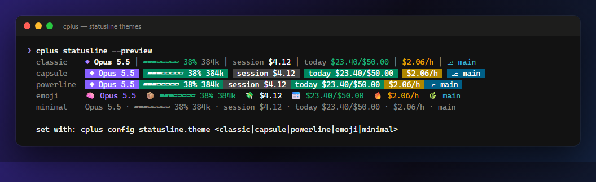
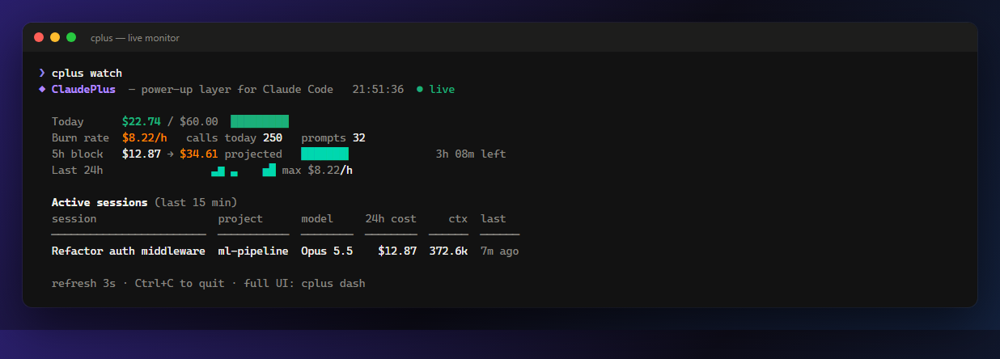
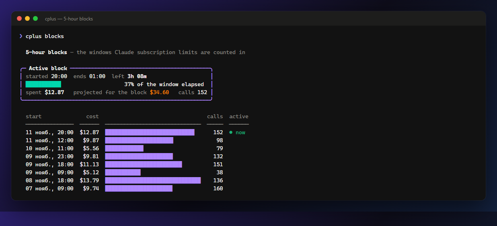
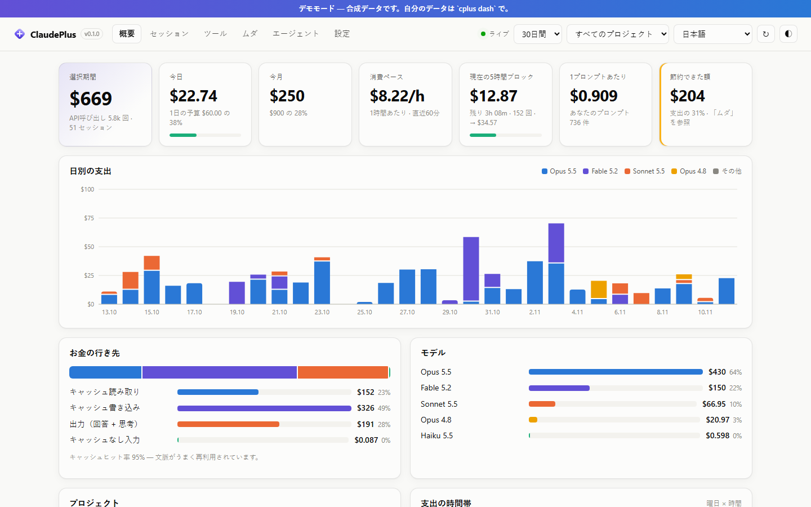

<div align="center">


<br>

[](https://github.com/bitovvnew/claudeplus/actions/workflows/ci.yml)


**The open-source power-up layer for [Claude Code](https://code.claude.com).**<br>
Know exactly what every session, project, model and tool costs. Catch the patterns that quietly burn tokens and stop them *before* they run. Manage a library of 62 subagents from one place.

[**Quick start**](#-quick-start) · [**Try the demo**](#-try-it-in-10-seconds-no-data-needed) · [**Features**](#-features) · [**Agents**](docs/AGENTS.md) · [**How it works**](#-how-costs-are-computed) · [**FAQ**](#-faq)

</div>

---


## ⚡ Quick start

```bash
git clone https://github.com/bitovvnew/claudeplus.git claudeplus
cd claudeplus && npm link        # puts `cplus` on your PATH — nothing to npm install
cplus                            # scan your Claude Code history and print the overview
cplus install                    # add the statusline + Guard hook (settings.json is backed up first)
cplus dash                       # open the dashboard → http://127.0.0.1:4317
```

Open a new Claude Code session afterwards. `cplus uninstall` puts everything back, including your previous statusline.

### 🎮 Try it in 10 seconds (no data needed)

```bash
cplus demo           # dashboard on synthetic data
cplus demo waste     # any command works on the demo dataset
```

## 📈 By the numbers

| | |
|---|---|
| **0** | runtime dependencies. Plain Node 18+, nothing to `npm install`, nothing phoning home |
| **325 MB/s** | transcript parsing. 284 MB of history (53k API calls) is scanned in **0.88 s** cold and **46 ms** warm |
| **~49 ms** | statusline refresh. It only reads the bytes added since the last refresh, so a fresh `node` process takes 34 ms to start and ClaudePlus adds about 15 ms |
| **~45 ms** | Guard overhead per tool call |
| **6** | leak detectors, each with an estimated $ amount and a concrete fix |
| **62 / 10** | ready-made subagents / curated packs |
| **16** | UI languages |
| **5** | statusline themes |
| **3 OS × 3 Node** | CI matrix (Windows, macOS, Linux × Node 18/20/22) |

<sub>Measured with <code>npm run bench</code> on synthetic data (i5-12400F, Windows 11, Node 26). Reproduce it on your machine.</sub>

In the author's own month of heavy Claude Code use, the leak report flagged **≈40% of API-equivalent spend as avoidable**. Most of it was context re-cached after idle gaps and calls running with 200k+ tokens of context. Your number will differ, so run `cplus waste` and see.

## ✨ Features

### 💸 Know where every dollar goes

Every API call in every session is priced per model: input, output (including thinking), 5-minute and 1-hour cache writes, cache reads, fast mode and web search. You can slice it by day, project, model, session, tool, subagent, weekday × hour and **5-hour block** (the window subscription limits are counted in). Copies of messages made by `--resume` are de-duplicated, so nothing is billed twice.


### 🕳 Find the leaks

`cplus waste` and the **Leaks** tab put a price on the habits that silently cost the most:

| Detector | What it catches |
|---|---|
| **Cache rebuilt after idle gaps** | You came back after the cache expired (5 min / 1 h), so the whole context was written to cache again at 1.25–2× the input price |
| **Oversized context** | Calls running with more than 200k tokens. Every one of them re-reads everything |
| **Premium subagents** | Search and read work done on Opus/Fable that Sonnet or Haiku could do for a fraction |
| **Duplicate reads** | The same unchanged file read in full again and again |
| **Giant tool outputs** | `cat`, logs and lockfiles flooding the context |
| **Thinking share** | How much of your output is thinking, and when lowering effort makes sense |


### 🛡 Guard: stop waste *before* it happens

A `PreToolUse` hook that intercepts the calls that burn tokens for nothing:

- re-reading a file that has not changed since Claude last read it
- a full `Read` of a huge file, where Claude is asked to use Grep plus offset/limit instead
- `git log` with no limit, `ls -R`, `find /`, `tree`, `Get-ChildItem -Recurse`, `cat package-lock.json`, `docker logs` with no `--tail`…
- optionally, a hard stop at your daily budget

It uses a **deny-once** policy: Claude gets a short explanation, and **an identical retry always goes through**, so it is never stuck when it really needs the data. Every decision is logged and shown in the dashboard.

### ▰ A statusline that tells you the truth

Model, context fill, live session cost, today's spend against your budget, burn rate and git branch, in 5 themes:



### 📡 Live monitor and 5-hour blocks

<table><tr>
<td width="50%"></td>
<td width="50%"></td>
</tr></table>

### 🔎 Drill into any session

Cost per prompt, peak context, subagent spend, context growth over time (spot the moment `/compact` would have paid off), cost by tool and that session's own leaks.


### 🤖 62 agents, 10 packs, one switchboard

List, enable or disable, edit, re-model and delete your Claude Code subagents (user and project scope), from the CLI or the dashboard. Disabling is reversible: the file just moves to `.claude/agents.disabled`.

The library is **cost-aware**: 🟢 Haiku for reading, searching and mechanical work, 🔵 Sonnet for engineering, 🟠 Opus only for design and planning. Full catalog: **[docs/AGENTS.md](docs/AGENTS.md)**.

```bash
cplus agents pack essentials   # scout, code-reviewer, debugger, test-runner, planner, refactorer
cplus agents pack cost-saver   # cheap-researcher, bulk-editor, diff-summarizer, context-keeper, repo-mapper…
cplus agents pack frontend     # react, next, vue, svelte, css, tailwind, ui-designer, a11y…
```


### 🌍 16 languages, light and dark

English · Русский · Українська · Español · Português · Français · Deutsch · Italiano · Polski · Türkçe · 中文 · 日本語 · 한국어 · हिन्दी · Bahasa Indonesia · Tiếng Việt

The language is picked from your system automatically. Change it with `cplus lang <code>` or the selector in the dashboard header.

<table><tr>
<td width="50%"></td>
<td width="50%"></td>
</tr></table>

## 🧰 Commands

```text
cplus                          overview: today, month, burn rate, models, projects, top sessions
cplus watch                    live terminal monitor
cplus blocks                   5-hour usage blocks
cplus daily | sessions | session <id|latest> | tools | models | projects
cplus waste                    leak report with $ estimates and fixes
cplus dash                     web dashboard (127.0.0.1 only)
cplus demo [command]           everything on synthetic data
cplus export [--json]          CSV/JSON export

  filters: -d 7 · --since 2026-11-01 · --since month · --until 2026-11-10 · -p <project>

cplus install [--statusline|--guard] · cplus uninstall · cplus doctor
cplus statusline --preview     see all themes
cplus agents [list|on|off|show|edit|model|rm|new|library|packs|pack|add]
cplus budget --daily 20 --monthly 300 [--stop on]
cplus lang <code|auto>         UI language
cplus config <key> <value>     e.g. cplus config statusline.theme capsule
cplus prices                   the price table in use
```

### Slash commands inside Claude Code (optional plugin)

```
/plugin marketplace add bitovvnew/claudeplus
/plugin install claudeplus@claudeplus
```

This adds `/claudeplus:cost`, `/claudeplus:leaks` and `/claudeplus:session-cost`.

## 🧮 How costs are computed

Claude Code writes the `usage` block of every API response to `~/.claude/projects/**/*.jsonl`. ClaudePlus:

1. **Merges** the several transcript lines a single API call is written as (same `message.id` + `requestId`).
2. **De-duplicates** history copied into new transcripts by `--resume`/forks, and credits each call to the session that actually made it.
3. **Prices** each call with the model's list price:
   - input and output (output includes thinking);
   - cache writes, at 1.25× input for the 5-minute TTL and 2× for the 1-hour TTL;
   - cache reads;
   - ×2 for fast mode, $10 per 1,000 web searches, and Haiku 5.5's long-prompt tier.
4. **Caches** the parsed results, so later runs only re-read transcripts that changed.

These are **API list-price equivalents**. On a Pro/Max subscription you don't pay per token, but the numbers still show which work is heavy and where your usage limits go. Prices live in [`src/pricing.js`](src/pricing.js). Override or add models in `~/.claudeplus/config.json`:

```json
{ "pricing": { "my-proxy-model": { "input": 1, "output": 5, "cacheRead": 0.1 } } }
```

## 🔒 Privacy and safety

- **100% local.** No telemetry, no network calls, no accounts. The dashboard binds to `127.0.0.1`, rejects foreign `Host` headers (which blocks DNS rebinding) and requires a custom header on every write.
- **Read-only on your history.** Transcripts are only ever read.
- **Reversible.** `settings.json` is backed up to `~/.claudeplus/backups/` before every change. Removed agents go to `~/.claudeplus/trash/`.
- **Hooks never break Claude Code.** Any error inside Guard or the statusline is swallowed silently.

| Path | What |
|---|---|
| `~/.claudeplus/config.json` | language, budgets, guard, statusline theme, price overrides |
| `~/.claudeplus/scan-cache.json` | parsed transcript cache (safe to delete) |
| `~/.claudeplus/guard-log.jsonl` | what Guard stopped |
| `CLAUDE_CONFIG_DIR`, `CLAUDEPLUS_HOME` | env vars to point at other locations |

## ❓ FAQ

**Is this a fork of Claude Code?**<br>
No. ClaudePlus doesn't modify Claude Code. It reads the transcripts Claude Code already writes and plugs in through the official extension points: statusline, hooks, subagents and plugins. It keeps working as Claude Code updates.

**Will Guard make Claude worse?**<br>
Guard only stops a call once, and an identical retry always passes. In practice Claude reuses what it already has or narrows the command, which is what you would have told it to do. Use `cplus config guard.mode warn` to only advise, or `off` to disable it.

**I'm on a subscription. Is this useful?**<br>
Yes. The 5-hour blocks, burn rate and leak report show where your limits go and which habits drain them fastest.

**Do the numbers match my invoice?**<br>
They use public list prices and the exact token counts from your transcripts. Custom contracts, batch discounts and taxes are not modeled.

**Does it work on Windows?**<br>
It was built on Windows and is tested on Windows, macOS and Linux in CI.

## 🗺 Roadmap

- Weekly digest (`cplus report --week`) with trend arrows
- More leak detectors: retry storms, oversized MCP tool lists, idle subagents
- Team mode: merge exports from several machines
- More statusline segments and themes, plus community translations

Ideas are welcome. [Open an issue](https://github.com/bitovvnew/claudeplus/issues).

## 🤝 Contributing

```bash
npm test                  # node:test, zero dependencies
npm run demo              # dashboard on synthetic data
npm run bench             # performance numbers
npm run screenshots       # regenerate docs/img (demo data only)
npm run library           # rebuild the agent library + docs/AGENTS.md
```

PRs for new agents, leak detectors, translations and themes are especially welcome. See [CONTRIBUTING.md](CONTRIBUTING.md).

## License

[MIT](LICENSE). ClaudePlus is an independent community project and is not affiliated with or endorsed by Anthropic. "Claude" and "Claude Code" are trademarks of Anthropic.
